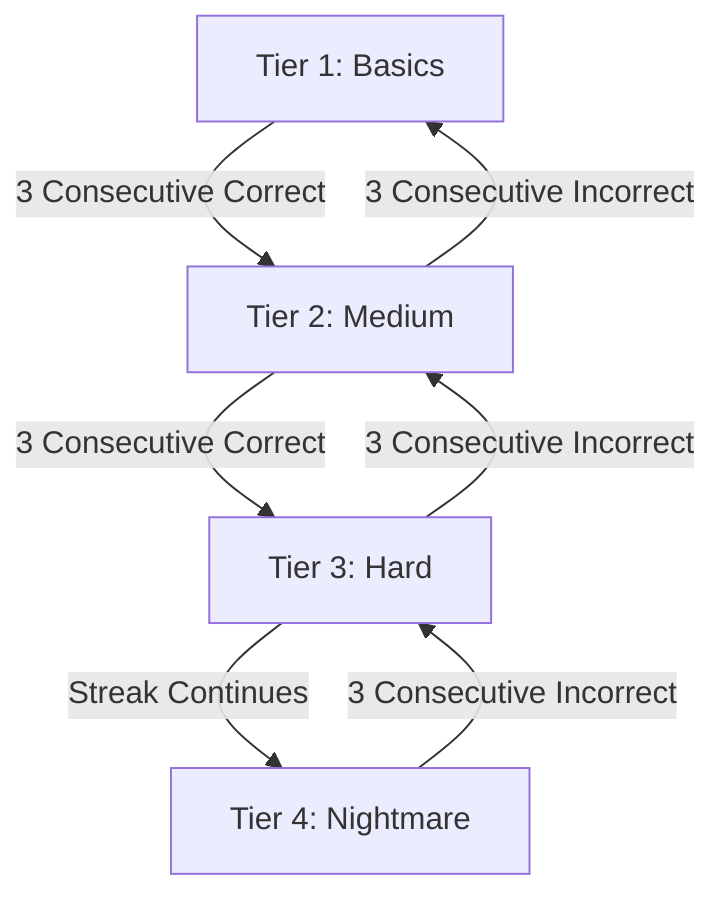

# DEBUGGED: 2-Minute Workshop Primer and Speaker Script

> Goal: Provide participants with a fast, intuitive mental model of web development in under 2 minutes so they can crack Tier 1 and Tier 2 challenges logically, while facing adaptive challenges when on a streak.

---

## 2-Minute Presenter Script (Read Before Starting)

> "Welcome everyone! Today, we aren't going to spend time memorizing dictionary definitions.
> Software engineering is about Pattern Recognition.
>
> In 60 seconds, you are going to compete against everyone in this room on your phone in DEBUGGED.
> The game adapts to your skill in real-time:
> - Answer correctly, and the game throws harder and more interesting challenges at you.
> - Make mistakes, and it drops you back to the basics so you can recover your streak.
>
> Here are the 4 Golden Patterns of Web Development you need to know to top the leaderboard:"

---

## The 4 Golden Patterns

### 1. Pattern 1: Matching Pairs and Exact Spelling
Computers execute code literally without guessing intent:
- **Tags must match**: `<button>` closes with `</button>` (not `</btn>`).
- **Keywords cannot have typos**: Use `const`, `let`, `function` (never `cosnt`, `funtion`, `lenght`).
- **Constants cannot be reassigned**: `const x = 10; x = 20;` throws a runtime error.
- **Comparison vs Assignment**: Single `=` assigns a value (`x = 5`). Triple `===` compares values (`x === 5`).

### 2. Pattern 2: The Client-Server Conversation
Web applications operate via continuous network requests and responses:
```
[Browser / Client]                   [Cloud Server / API]
 (Renders pixels, UI)                 (Processes logic, database)
          |                                       |
          |---- 1. Request (GET /api/scores) ---->|
          |<--- 2. Response (Status + JSON) ------|
```
- **HTTP Status Codes**:
  - `200 OK`: Request succeeded.
  - `404 Not Found`: The URL or endpoint does not exist.
  - `500 Server Error`: Backend execution failed.

### 3. Pattern 3: CSS Properties and Specificity
- CSS follows `property: value;` formatting (`color: red;`, `padding: 16px;`). Misspellings such as `colr: blue;` are ignored by browsers.
- **Specificity**: `#id` selectors have higher priority than `.class` selectors.

### 4. Pattern 4: JavaScript Edge Cases
JavaScript contains specific behavior patterns tested in higher tiers:
- `0.1 + 0.2 === 0.3` is `false` due to binary floating-point representation (`0.30000000000000004`).
- `typeof NaN` evaluates to `"number"`.
- `typeof null` evaluates to `"object"` due to historic specification compatibility.
- `[10, 2, 1].sort()` sorts alphabetically by default, resulting in `[1, 10, 2]`.

---

## Adaptive Difficulty Engine



- **Tier 1 (Easy / Basics)**: Syntax typos (`cosnt`), HTML tag mismatches (`</btn>`), HTTP status codes.
- **Tier 2 (Medium / Standard)**: `const` reassignment, object commas, async `fetch` pipelines.
- **Tier 3 (Hard / Advanced)**: Coercion equality (`0 == false`), array mutation vs reassignment, CSS specificity.
- **Tier 4 (Nightmare / Extreme)**: IEEE floating-point arithmetic, `typeof NaN`, default array `.sort()`, microtask event loop ordering.
- **Dynamic Scoring**: Higher difficulty tiers award bonus base points (`Tier 1: 100`, `Tier 2: 130`, `Tier 3: 160`, `Tier 4: 190` points) alongside combo multipliers.

---

## Presenter Flow on Tournament Day
1. **Open Host View**: Display `http://localhost:3000/host` on the auditorium projector.
2. **Scan QR Code**: Participants scan the on-screen QR code on their mobile devices.
3. **Present Primer**: Deliver the 2-minute overview of the 4 Golden Patterns.
4. **Start Match**: Count down and start the 60-second round.
5. **Monitor Live Board**: Observe real-time podium updates and activity stream on the main display.
6. **Open Presenter Reveal**: Transition to the slide deck explaining DOM, WebSockets, and Web Audio architecture.
